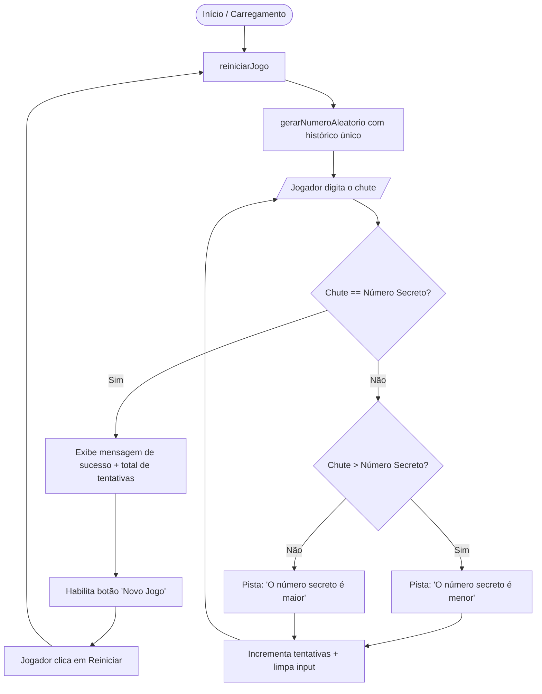

# 🎯 Jogo do Número Secreto (Secret Number Game)

Uma aplicação web interativa desenvolvida com **JavaScript Vanilla**, **HTML5** e **CSS3**, focada na prática de fundamentos de lógica de programação, manipulação dinâmica do DOM (Document Object Model) e recursos de acessibilidade com sintetização de voz (**Web Speech / ResponsiveVoice**).

<p align="left">
  
  
  
  
  
</p>

---

> ℹ️ **Nota de Origem e Créditos**:  
> Este projeto foi desenvolvido como **exercício prático guiado durante uma aula da Alura**. A concepção, layout base e proposta original pertencem ao curso de formação da **Alura**. O código aqui presente reflete a minha implementação prática, acompanhamento dos conceitos de aula e eventuais ajustes para consolidação do aprendizado em lógica e JavaScript.

---

## 📌 Visão Geral

O projeto consiste em um jogo clássico de adivinhação onde o usuário tenta descobrir um número pseudialeatório gerado pelo sistema entre 1 e 10. A aplicação fornece dicas contextuais ("o número secreto é maior" ou "o número secreto é menor") e contabiliza a quantidade de tentativas necessárias até o acerto.

### 🌟 Conceitos Praticados Durante a Aula

- **Recursão com Controle de Histórico Único**: A função `gerarNumeroAleatorio()` sorteia números usando recursão em conjunto com a lista `listasDeNumerosAcertados`, impedindo a repetição de um mesmo número até que todos os 10 valores possíveis tenham sido sorteados.
- **Manipulação Dinâmica do DOM**: Utilização da função `exibirTextoNaTela(tag, Texto)` para injetar mensagens e títulos dinamicamente no HTML sem duplicação desnecessária de código.
- **Controle de Estado e Acessibilidade**: Habilitação/desabilitação de botões (`reiniciar.removeAttribute('disabled')`), limpeza e foco do campo de input, além de suporte a leitura e sintetização por voz (ResponsiveVoice).

---

## 🔄 Fluxo e Lógica do Jogo



---

## 🚀 Como Executar Localmente

Por se tratar de uma aplicação puramente cliente:

1. **Clonar o repositório:**
   ```bash
   git clone https://github.com/DouglasScarello/Jogodonumerosecreto.git
   cd Jogodonumerosecreto
   ```

2. **Abrir a aplicação:**
   Basta abrir o arquivo `index.html` em qualquer navegador:
   ```bash
   xdg-open index.html
   ```

---

## 📁 Estrutura de Arquivos

```text
Jogodonumerosecreto/
├── app.js            # Lógica do jogo (recursão, verificação e DOM)
├── index.html        # Estrutura HTML e scripts de suporte
├── style.css         # Estilização visual e responsividade
├── img/              # Imagens e assets da aula
└── README.md         # Documentação e atribuição
```

---

## 🎓 Atribuição e Aprendizado

Projeto realizado como prática de estudo na **Alura** para fixação de sintaxe ECMAScript, escopo de variáveis, funções e fluxo de controle.

Desenvolvido e acompanhado por **[Douglas Scarello](https://github.com/DouglasScarello)** 🚀
